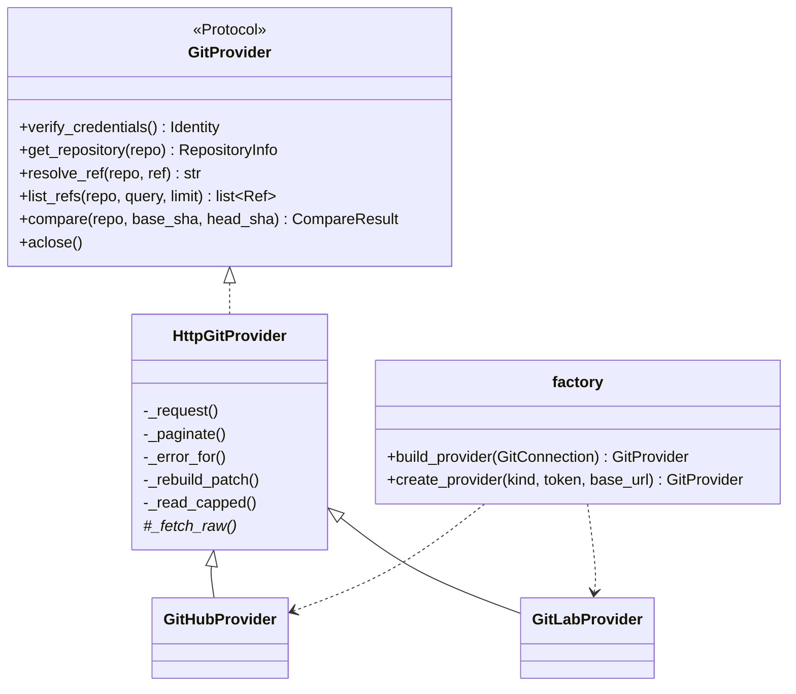

# Spec: M1 — Git Integration (GitHub + GitLab)

| | |
|---|---|
| **Milestone** | M1 Git Integration (Phase 1) |
| **Status** | ✅ Implemented & verified (2026-10-12), tested against fake APIs |
| **Owners** | Dev B (providers), Dev A (factory/health) |
| **Related** | [M0 spec](M0-foundation.md) · [Product spec](../releaseradar_product_specification.md) §5 (`git_connections`) · [Roadmap](../releaseradar_phased_roadmap.md) Phase 1 |

---

## 1. Purpose & Scope

M1 gives ReleaseRadar **read-only access to Git hosts** through one provider-agnostic interface. The analysis engine (M2) only ever sees the normalized `CompareResult` / `FileDiff` models. It never knows which host a diff came from.

**In scope**

| ID | Feature |
|---|---|
| G1 | `GitProvider` protocol + normalized models (`Identity`, `RepositoryInfo`, `Ref`, `Commit`, `FileDiff`, `CompareResult`) |
| G2 | Typed error hierarchy (auth, access, not found, rate limit, unsupported) |
| G3 | Shared HTTP plumbing: error mapping, `Link` pagination, injected/owned `httpx` client |
| G4 | GitHub provider (github.com + GitHub Enterprise Server) using a personal access token |
| G5 | GitLab provider (gitlab.com + self-managed, nested groups) using a personal/project/group access token |
| G6 | Patch fallback: rebuild omitted/collapsed patches from raw file contents, with a budget |
| G7 | Factory: `GitConnection` row → provider client (decrypts the token) |
| G8 | Token health: verify a token, record `last_verified_at` / `token_expires_at`, 14-day expiry warning |

**Out of scope:** Bitbucket (Phase 4), GitHub App installations (`auth_type = APP_INSTALLATION` is reserved and rejected), webhooks, the HTTP endpoints that expose these features (M3).

---

## 2. Architecture



| Path | Responsibility |
|---|---|
| [`app/integrations/git/base.py`](../../backend/app/integrations/git/base.py) | Protocol, normalized models, errors |
| [`app/integrations/git/http.py`](../../backend/app/integrations/git/http.py) | `HttpGitProvider`: requests, error mapping, pagination, patch fallback |
| [`app/integrations/git/github.py`](../../backend/app/integrations/git/github.py) | GitHub REST v3 mapping |
| [`app/integrations/git/gitlab.py`](../../backend/app/integrations/git/gitlab.py) | GitLab REST v4 mapping |
| [`app/integrations/git/diffutil.py`](../../backend/app/integrations/git/diffutil.py) | Counting, header stripping, patch building, binary sniffing |
| [`app/integrations/git/factory.py`](../../backend/app/integrations/git/factory.py) | Connection → provider |
| [`app/services/git_connections.py`](../../backend/app/services/git_connections.py) | Token verification + expiry health |

Import from `app.integrations.git`, not from the provider modules.

---

## 3. Normalized Model

| Model | Fields | Notes |
|---|---|---|
| `FileDiff` | `path`, `old_path`, `status` (`ChangeType`), `additions`, `deletions`, `patch`, `is_binary`, `patch_omitted` | `patch` is headerless unified hunks starting with `@@`. `old_path` is set only for renames. |
| `CompareResult` | `base_sha`, `head_sha`, `commits`, `files`, `truncated` | `truncated` = the provider did not return the full change set |
| `Ref` | `name`, `kind` (branch/tag), `sha` | `sha=None` for GitHub annotated tags; use `resolve_ref` |
| `Identity` | `username`, `display_name`, `token_expires_at` | Expiry only when the host reports it |

**State of a file's content** (what M2 must handle):

| `patch` | `is_binary` | `patch_omitted` | Meaning |
|---|---|---|---|
| text | false | false | Normal change |
| `None` | false | false | No content change (pure rename, empty file) |
| `None` | true | false | Binary file |
| `None` | false | true | Text change we could not obtain (budget or size cap hit). The engine must report it as "not analyzed". |

Compare semantics are **merge-base** on both hosts: GitHub `base...head`, GitLab `straight=false`.

---

## 4. Provider Mapping

| Concern | GitHub | GitLab |
|---|---|---|
| Auth header | `Authorization: Bearer <PAT>` | `PRIVATE-TOKEN: <token>` |
| Default `base_url` | `https://api.github.com` | `https://gitlab.com/api/v4` |
| Repo identifier | `owner/name` (validated) | `group/sub/project`, URL-encoded as one segment (`acme%2Fplatform%2Fapi`) |
| Verify | `GET /user`. Expiry comes from the `github-authentication-token-expiration` header | `GET /user`. Expiry comes from `GET /personal_access_tokens/self` (`expires_at` date, treated as 23:59:59 UTC). A missing endpoint is tolerated. |
| Resolve ref | `GET /repos/{r}/commits/{ref}` with `Accept: application/vnd.github.sha`. 404 and 422 become `NotFoundError`. | `GET /projects/{p}/repository/commits/{ref}`. 404 becomes `NotFoundError`. |
| List refs | `git/matching-refs/heads/{q}` + `tags/{q}` (prefix match) | `repository/branches?search=` + `tags?search=` |
| Compare | `GET /compare/{base}...{head}?per_page=100`, commits paginated via `Link`; files read from page 1 only | `GET /repository/compare?from&to&straight=false` |
| Status | `added/copied→ADDED`, `removed→REMOVED`, `renamed→RENAMED`, else `MODIFIED` | `new_file` / `deleted_file` / `renamed_file` flags |
| Binary | no patch, `changes == 0`, not a rename | `diff` contains `Binary files … differ` and no hunk |
| Omitted patch | no `patch` but `changes > 0` | empty `diff` with `too_large` or `collapsed` |
| `truncated` | ≥ 300 files **or** fewer commits than `total_commits` | `compare_timeout` **or** ≥ 1000 diffs |
| Raw content | `GET /contents/{path}?ref=` with `Accept: application/vnd.github.raw+json` | `GET /repository/files/{path}/raw?ref=` |
| Diff headers | none | Stripped if present (older instances include `---`/`+++`) |

---

## 5. Patch Fallback

When a host omits a text patch, the provider fetches the file at `base_sha` and `head_sha` and rebuilds the hunks with `difflib`, using the same headerless format.

| Limit | Default | When exceeded |
|---|---|---|
| Files rebuilt per compare | 25 (`fallback_max_files`) | `patch_omitted=True` |
| Bytes per side | 256 KiB (`fallback_max_bytes`), streamed and aborted early | `patch_omitted=True` |
| Content is binary (NUL byte or not UTF-8) | — | `is_binary=True` |
| File missing at a side (404) | — | `patch_omitted=True` |

Added files skip the base fetch. Removed files skip the head fetch. Renames read the base from `old_path`.

---

## 6. Errors

| HTTP | Error | Notes |
|---|---|---|
| 401 | `AuthenticationError` | Invalid, expired or revoked token |
| 403 with `x-ratelimit-remaining: 0` or `retry-after` | `RateLimitError` | `retry_after_seconds` is parsed when numeric |
| 403 | `AccessDeniedError` | Missing scope or repo access |
| 404 | `NotFoundError` | Also returned for repos the token cannot see |
| 429 | `RateLimitError` | |
| Other ≥ 400 | `GitProviderError` | `status_code` is set |
| Timeout / network | `GitProviderError` | `status_code=None` |

**Security:** tokens are only ever placed in request headers. Error messages never include tokens, URLs with credentials, or response bodies. Tests assert this for every status.

---

## 7. Factory & Token Health

- `build_provider(connection, decrypt=decrypt_secret)` decrypts `access_token_encrypted` and uses `connection.base_url` as the API root. It raises `UnsupportedProviderError` in three cases:
  - Bitbucket
  - `APP_INSTALLATION` connections
  - a missing token
- `verify_connection(connection, provider)` calls `verify_credentials()` and sets `last_verified_at`. It sets `token_expires_at` only when the host reports one, so a manually entered expiry is kept. Errors propagate unchanged. The caller owns the DB session.
- `token_health(expires_at)` returns one of four states:
  - `UNKNOWN`: no expiry known
  - `EXPIRED`
  - `EXPIRING_SOON`: 14 days or less
  - `OK`

### Required token scopes

| Host | Token type | Minimum scope |
|---|---|---|
| GitHub | Fine-grained PAT | Repository access to the target repos. Permissions: **Contents: read**, **Metadata: read** |
| GitHub | Classic PAT | `repo` (private) or `public_repo` |
| GitLab | Personal / group / project access token | `read_api` (`read_repository` alone is not enough for the REST compare API) |

---

## 8. Usage

```python
from app.integrations.git import build_provider

async with build_provider(connection) as git:
    base = await git.resolve_ref(project.repo_identifier, "main")
    head = await git.resolve_ref(project.repo_identifier, "release/1.4")
    result = await git.compare(project.repo_identifier, base, head)
```

---

## 9. Verification

| Suite | File | What it proves |
|---|---|---|
| **Contract** (both hosts) | [`tests/integrations/test_contract.py`](../../backend/tests/integrations/test_contract.py) | The same scenario produces an **identical** `CompareResult` on both hosts: modified, added, removed, pure rename, rename+edit, large file rebuilt, binary. Also covers commit order, fallback budget and size cap, raw fetches only for omitted patches, token in headers only, and unknown ref → `NotFoundError`. |
| GitHub | [`test_github.py`](../../backend/tests/integrations/test_github.py) | Pagination without duplicated files; 300-file cap; missing commits; 422 ref; expiry header; annotated tags; repo validation; binary detected on rebuild |
| GitLab | [`test_gitlab.py`](../../backend/tests/integrations/test_gitlab.py) | Nested-group encoding; `compare_timeout`; 1000-diff overflow; `too_large` rebuild; header stripping; token expiry with and without the endpoint; refs search |
| Errors | [`test_errors.py`](../../backend/tests/integrations/test_errors.py) | Status → error type on both hosts; `retry-after`; network/timeout wrapping; tokens never leak; client ownership |
| Factory/health | [`test_factory_and_health.py`](../../backend/tests/integrations/test_factory_and_health.py) | Connection → provider; cloud defaults; unsupported cases; expiry thresholds; verification bookkeeping |
| Diff utils | [`tests/unit/test_diffutil.py`](../../backend/tests/unit/test_diffutil.py) | Hunk-aware counting (including removed `-- ` SQL comments), header stripping, patch building, binary sniffing |

> [!NOTE]
> The fake APIs ([`tests/integrations/fakes.py`](../../backend/tests/integrations/fakes.py)) are hand-built from the public REST docs. **Next step:** record real responses from a test GitHub repo and a test GitLab project (tokens scrubbed) and add them as fixtures. Run a manual smoke test against both hosts before the first pilot.

---

## 10. Known Limitations

- GitHub: a newly added **empty** file looks like a binary file (no patch, 0 changes). The impact is low, because the engine skips both.
- GitHub compare returns at most 300 files in total. Commits are paginated, up to 50 pages of 100. Past either cap, `truncated=True`, and M2 must show a "partial analysis" banner.
- Mode-only changes (chmod) are reported as `MODIFIED` with no patch.
- No retry or backoff yet. `RateLimitError.retry_after_seconds` is exposed so the M3 worker can reschedule.
