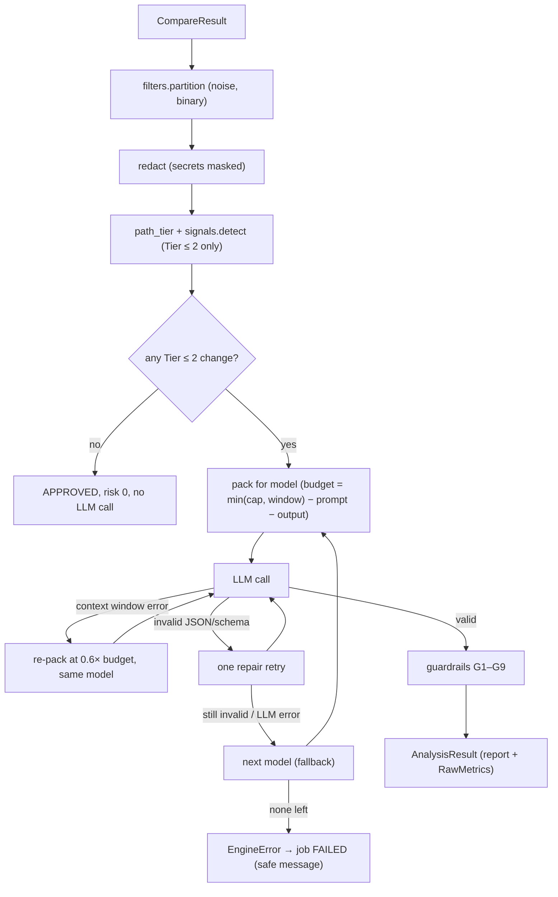

# Spec: M2 — Analysis Engine

| | |
|---|---|
| **Milestone** | M2 Analysis Engine (Phase 1) |
| **Status** | ✅ Implemented (2026-10-12), tested with a fake LLM. ⚠️ **No real-model baseline yet** |
| **Owners** | Dev C (engine, prompts), Dev A (review runner, worker), founder (eval cases) |
| **Related** | [M1 spec](M1-git-integration.md) · [Product spec](../releaseradar_product_specification.md) §6–7 |

---

## 1. Purpose & Scope

M2 turns a `CompareResult` (from M1) into a validated `ReleaseReviewReport`. The report has a verdict, a 0–100 risk score, hazards, a deployment checklist and a rollback assessment. Deterministic code does everything it can. The LLM only does the judgement. Guardrails then check the LLM's output against facts found in the diff.

**In scope**

| ID | Feature | Module |
|---|---|---|
| E1 | Noise filter (lockfiles, build output, media, vendored, generated) | `app/engine/filters.py` |
| E2 | Secret redaction before anything leaves the process | `app/engine/redact.py` |
| E3 | Path tiering (1 critical · 2 core · 3 low) + signal promotion | `app/engine/tiering.py` |
| E4 | Deterministic signals (env vars, destructive SQL, migrations, routes, dependencies) | `app/engine/signals.py` |
| E5 | Versioned prompts (`prompts/v1`) + JSON schema | `app/engine/prompt.py` |
| E6 | Token budgeting + packing per model | `app/engine/budget.py` |
| E7 | LLM client (LiteLLM: Gemini primary, Groq fallback) + fake | `app/engine/llm.py` |
| E8 | Guardrails G1–G9 | `app/engine/guardrails.py` |
| E9 | Pipeline: short-circuit, repair retry, context-window retry, fallback | `app/engine/pipeline.py` |
| E10 | Review runner (DB job lifecycle), Celery task, `rr review` | `app/services/reviews.py`, `app/workers/tasks.py`, `app/cli.py` |
| E11 | Eval harness + 10 seed cases, `rr eval`, manual workflow | `app/evals/`, `evals/`, `.github/workflows/evals.yml` |

**Out of scope:** HTTP endpoints and sign-off (M3), UI (M4), map-reduce over huge diffs, AST-based detectors.

---

## 2. Pipeline



`analyze(compare, context, llm, settings)` is pure apart from the LLM call. It knows nothing about the DB or the git host. `ENGINE_VERSION = "0.2.0"`, `PROMPT_VERSION = "v1"`.

---

## 3. Deterministic Rules

### 3.1 Tiers

| Tier | Examples |
|---|---|
| 1 CRITICAL | migrations, API contracts (OpenAPI/proto/GraphQL), routers/controllers, config & infra (Docker, k8s, Terraform, CI), dependency manifests, auth/security code |
| 2 CORE | all other source code |
| 3 LOW | tests, docs, examples, fixtures |

The order of checks is manifests → Tier 3 → Tier 1, so `tests/requirements.txt` is still Tier 1. A Tier 2 file with a strong signal (env var, destructive SQL, route change, migration) is promoted to Tier 1.

### 3.2 Signals

| Kind | Detection |
|---|---|
| `ENV_VAR_ADDED` / `REMOVED` | `os.environ`, `getenv`, `process.env`, `ENV[]`, `System.getenv`, `os.Getenv`, … ; `${VAR}` only in config/shell; `.env.example` lines. Diff-wide: a var both added and removed is not reported |
| `DESTRUCTIVE_SQL` | `DROP TABLE/COLUMN`, `RENAME`, `ALTER … TYPE`, `op.drop_*`, … ignoring `downgrade`/`down` sections; `DELETE FROM` only in migrations |
| `MIGRATION_ADDED` | new file in a migrations path |
| `ROUTE_REMOVED` / `CHANGED` | FastAPI/Flask, Express, Spring, NestJS, Rails, Django and Go route declarations |
| `DEPENDENCY_CHANGED` | changed lines in manifests |

Signals are passed to the LLM as facts and are used by the guardrails.

### 3.3 Redaction

The following are masked before any prompt is built: known token formats (GitHub, GitLab, AWS, Stripe, OpenAI-style, Slack, Google, Groq, JWT), URL credentials, private-key blocks, and high-entropy quoted strings (entropy ≥ 4.5). In config files, `SECRET_KEY=value` keeps the name and masks the value. Placeholders such as `changeme` and `${…}` are kept. The count goes into `raw_metrics.redactions`.

---

## 4. Budgeting

- Input cap: `min(model cap, context window) − system prompt − max output`. Caps are `RR_LLM_INPUT_CAP_PRIMARY=150000` and `RR_LLM_INPUT_CAP_FALLBACK=90000`.
- Token counting uses LiteLLM's `token_counter` × 1.1 as a safety margin.
- Packing order: tier → has signals → smaller first. One file may use at most 25 % of the budget.
- Oversized files are truncated by whole hunks, falling back to a binary search over lines. Files left with fewer than `MIN_USEFUL_TOKENS=300` are skipped as `BUDGET`.
- Coverage is `PARTIAL` when any Tier 1/2 file was skipped or truncated, or when the provider truncated the compare.

---

## 5. Guardrails

Guardrails only make a report **stricter**. The one exception is G1, which removes hazards that cite files that aren't in the diff. Each action is recorded in `raw_metrics.guardrail_actions`.

| Rule | Effect |
|---|---|
| G1 | Drop hazards citing files not in the diff |
| G2 | Merge duplicates (file + category + symbol), keep the higher severity |
| G3 | Clamp the risk score into the verdict's band: APPROVED 0–29, CAUTION 30–69, BLOCKED 70–100 (the verdict wins) |
| G4 | A CRITICAL hazard → at least APPROVED_WITH_CAUTION |
| G5 | Detected new env vars are added to `required_env_vars` (never removed) |
| G6 | Destructive SQL → `zero_downtime_rollback_safe = false` |
| G7 | New migration → a pre-deploy action is added |
| G8 | PARTIAL coverage → at least APPROVED_WITH_CAUTION |
| G9 | Hazards sorted CRITICAL → LOW, breaking first |

---

## 6. `raw_metrics` schema

The `RawMetrics` model is stored in `review_jobs.raw_metrics`:

```json
{
  "prompt_version": "v1", "engine_version": "0.2.0",
  "model": "gemini/gemini-2.5-pro", "fallback_used": false, "attempts": 1,
  "files_total": 42, "files_analyzed": 18, "additions": 900, "deletions": 310,
  "coverage": "FULL", "provider_truncated": false,
  "skipped_files": [{"path": "package-lock.json", "reason": "NOISE", "tier": null}],
  "truncated_files": [], "signals": {"ENV_VAR_ADDED": 1}, "redactions": 0,
  "guardrail_actions": [{"rule": "G5", "detail": "added env var STRIPE_KEY"}],
  "attempt_errors": [],
  "tokens": {"prompt": 31000, "completion": 1900}, "cost_usd": 0.058,
  "latency_ms": {"git": 1200, "llm": 21000, "total": 22400}
}
```

---

## 7. Review Runner

`run_review(job_id, …)` locks the job (`QUEUED` only, `FOR UPDATE SKIP LOCKED`) and sets it to `RUNNING`. It then fetches the compare through the M1 factory, runs `analyze`, and writes the verdict, hazards, prerequisites and metrics in one transaction. A FAILED job only ever gets a safe message: no tokens, no provider bodies. In the Celery task, a provider rate limit puts the job back to `QUEUED` and retries after `retry_after` (max 3 retries). Each task gets a fresh NullPool engine.

```bash
uv run rr review --project my-api --base v2.4.0 --target rc-2.5.0          # run inline, print report
uv run rr review --project my-api --base v2.4.0 --target rc-2.5.0 --enqueue
```

---

## 8. Evals

- Cases live in `backend/evals/cases/` (committed, hand-written) and `backend/evals/private/` (gitignored, pilot data).
- A case is either a `case.yaml` with inline `files`, or a recorded `compare.json` plus `expected.yaml`.
- `expected` holds: acceptable `verdict`s, `rollback_safe`, `required_env_vars`, `hazards` (category or list of categories, file glob, `min_severity`, `breaking`, fuzzy `symbol`), and `allowed_extra`, meaning findings that aren't false positives.
- Metrics and targets:

| Metric | Target |
|---|---|
| Tier 1 recall | ≥ 0.85 |
| Rollback accuracy | ≥ 0.90 |
| Env-var recall | ≥ 0.95 |
| False positives / case | ≤ 1.0 |
| Overall recall, verdict accuracy | reported |

```bash
uv run rr eval                         # primary model, cached responses
uv run rr eval --model both --no-cache --check
uv run rr eval --case 04-new-required-env-var
```

Results are written to `evals/results/<prompt_version>/<timestamp>-<model>.json`. Responses are cached in `evals/.cache/` (gitignored), keyed by model + messages. **Any prompt change needs a new results file in the PR.** The `Evals` GitHub workflow is manual only and needs repo secrets `RR_GEMINI_API_KEY` and `RR_GROQ_API_KEY`.

---

## 9. Configuration

| Variable | Default |
|---|---|
| `RR_LLM_PRIMARY_MODEL` | `gemini/gemini-2.5-pro` |
| `RR_LLM_FALLBACK_MODEL` | `groq/openai/gpt-oss-120b` (to be confirmed by evals) |
| `RR_GEMINI_API_KEY`, `RR_GROQ_API_KEY` | — |
| `RR_LLM_TIMEOUT_SECONDS` | 90 |
| `RR_LLM_MAX_OUTPUT_TOKENS` | 8192 |
| `RR_LLM_INPUT_CAP_PRIMARY` / `_FALLBACK` | 150000 / 90000 |

`litellm` is pinned (`==1.105.0`) because response-format handling changes between releases.

---

## 10. Verification

- `uv run pytest`: 307 tests pass (engine rules, signals, budget, prompt snapshot, guardrails, pipeline retries/fallback, review runner against Postgres, eval scoring and seed cases).
- ruff + mypy (strict) are clean.
- Every LLM interaction in the tests uses `FakeLLMClient`.

---

## 11. Known Limitations

- **No real-model baseline yet.** The prompt and the fallback model choice haven't been validated against Gemini or Groq.
- The seed cases are hand-built. Pilot cases (`evals/private/`) are needed before the targets mean much.
- Detectors use regexes, not ASTs. Unusual code styles can be missed, and the LLM is the safety net. Pydantic `BaseSettings` fields aren't detected as env vars.
- There is no map-reduce for huge diffs. Anything over the budget is skipped and the report is marked PARTIAL.
- Only the first model attempt is repaired once. There is no self-consistency or second opinion.
